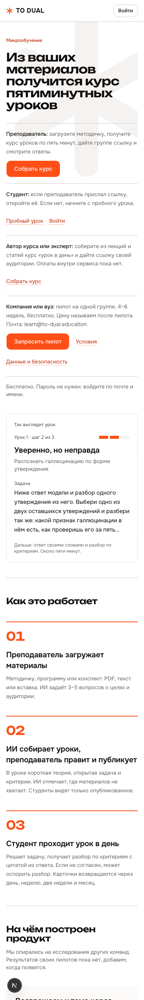
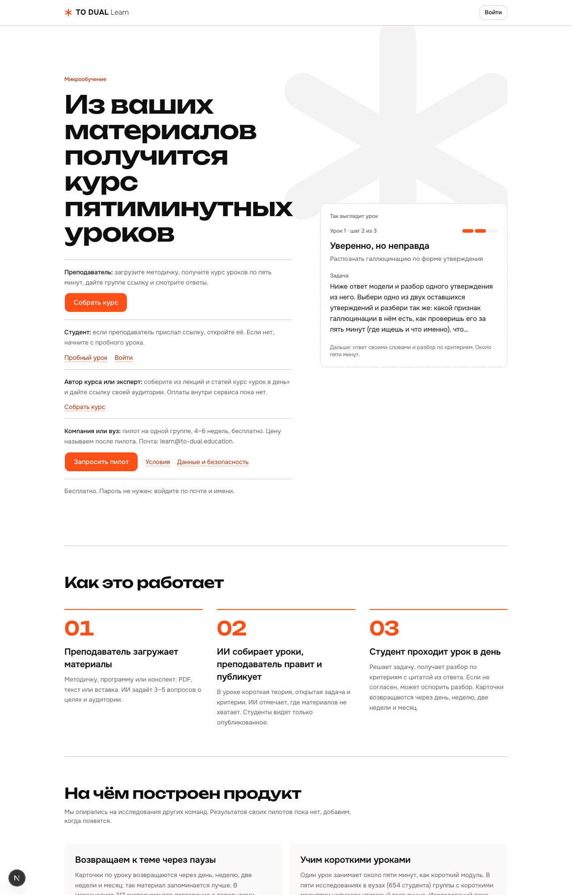

# Лендинг для ролей, /about/data и /pilot (16 октября 2026)

Основание: [live-walkthrough-2026-10-16.md](../../research/live-walkthrough-2026-10-16.md), правки 1 и 2.

## Что сделано

1. **Лендинг.** Под заголовком четыре строки-входа: преподаватель, студент, автор курса или эксперт, компания или вуз. У каждой своё действие. У компании «Запросить пилот» (письмо на learn@to-dual.education с готовой темой и шаблоном), «Условия» и «Данные и безопасность». Убраны «Для кого» и финальная панель, сокращены «Как это работает». Страница осталась статической.
2. **/about/data «Данные и безопасность».** Что храним, где, кто видит ответы, что получает поставщик ИИ, удаление, перенос в РФ без дат, защита. Ссылки на политику и согласие.
3. **/pilot «Пилот для компании или вуза».** Что входит, сроки, что нужно от заказчика, что получает, чего пока нет, цена после пилота, контакт. Источник: `docs/partnerships/hse-pilot-one-pager.md`, `corporate-vtb.md`.
4. Ссылки на обе страницы в подвале `PublicShell`. Обе страницы исключены из `proxy` (как `legal/`), чтобы их отдавал CDN.

Заявка на пилот идёт письмом (`src/lib/pilot.ts`), формы и базы под заявки нет.

## Проверки

- `npm run type-check`, `npm run lint` (0 ошибок), `npm run build`: проходят.
- `npm run text:lint`: 0 жёстких, у новых страниц два предупреждения (W24, W02) в `about/data`, разобраны редактором как допустимые.
- Роли: compliance, editor, designer, code-reviewer, по одному проходу. Принятые замечания внесены (см. ниже).

## Для юриста

Формулировки на `/about/data` и `/pilot`, которые нужно подтвердить. Вопросы сверки compliance:

1. **Обучение моделей.** В задаче предполагалось написать «не используется для обучения по условиям API». Политика (п. 4) говорит, что это не подтверждено, поэтому на странице написано «письменно не подтвердили, обещать не будем». Настройки OpenRouter против логирования и обучения в коде не заданы (`data_collection` не передаётся). Нужно проверить аккаунт OpenRouter и условия Anthropic; после подтверждения заменить абзац. Страница не говорит, что «мы сами не используем материалы для обучения» (terms п. 4 помечен «требует проверки юриста»).
2. **«Никто больше не видит ответы».** Написано мягче: студент и преподаватель курса в интерфейсе; технически команда, служебные процессы и поставщики. Не проверено, что режим входа `direct` выключен на проде и что роль нельзя сменить через `profiles update own` (data-map п. 4).
3. **Регионы.** Supabase «ЕС» и Vercel «Франкфурт» взяты из политики; data-map говорит, что регион не проверен, по умолчанию США. Открыть настройки проектов и оставить одну версию.
4. **Яндекс ID.** Страница говорит, что вход включается после регистрации приложения. Проверить статус.
5. **Обезличенность в пилоте.** Обезличены только работы по кодам (дорожка 1); участники, входящие по почте, не обезличены. Так и написано. Определение по ст. 3 п. 9 152-ФЗ на проверку.
6. **Цена и «Продолжать платно вы не обязаны».** Пилот бесплатный: нужна форма (акт о безвозмездном предоставлении, pilot-faq п. 6).
7. **Роли оператор и обработчик** названы «как правило оператор у заказчика»: подтвердить.
8. **Публичное признание:** договоров поручения нет, ст. 18 ч. 5 не выполняется, нет журнала администраторов и процедуры по инцидентам. Решить, публиковать ли это на странице. Часть уже есть в политике.
9. **Реквизиты оператора** (наименование, ИНН, ОГРН), ответственный по ст. 22.1, уведомление по ст. 12 и 22, дата редакции: на страницах пока нет, юрлица для указания нет. Политика п. 13 обещает реквизиты до пилотов.
10. Номера статей брала compliance из docs/legal, сами законы не перечитывала: сверить с текстом.

## Не сделано

- Форма заявки вместо письма: нужен адрес приёма и хранение, согласовать с partnerships.
- Контактное лицо и телефон в /pilot: в `docs/partnerships` стоит заглушка «[Имя Фамилия]».
- Строка «Студент» ведёт на пробный урок и вход; ссылка от преподавателя работает как раньше.
- Предупреждение сканера W13 в `page.tsx` («Преподаём…») существовало до правки.

## Скриншоты

Папка [landing-roles/](landing-roles/): `landing`, `data`, `pilot`, каждая в `-375.png` и `-1280.png`.

| | 375 | 1280 |
|---|---|---|
| Лендинг |  |  |
